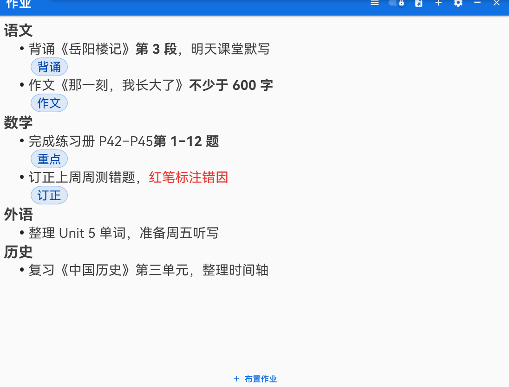

# StickyHomeworks3

> [!warning]
> 这个项目还在早期开发中

StickyHomeworks3 是一款支持富文本的桌面作业贴工具。



> 本项目是基于 [HelloWRC/StickyHomeworks](https://github.com/HelloWRC/StickyHomeworks) 的**分支版本**，由 20001lvmei 维护，遵循 GPLv3 许可。

## 功能

- [X] 登记与修改作业
- [X] 富文本支持
- [X] 按科目分组作业
- [X] 为作业添加标签
- [X] 主界面全局缩放
- [X] 自动归档过期作业（可恢复，不再直接删除）
- [X] 冻结（仅可查看，不能修改作业）
- [X] 时间机器（自动备份 + 一键恢复）
- [X] 作业模板（存为模板 / 一键套用）
- [X] 首次启动引导（选科目、设置开机自启）
- [X] 托盘图标（右下角，菜单：显示主界面 / 设置 / 重启 / 退出）
- [X] 导出作业截图
- [X] 作业历史记录（删除/归档的作业可找回）
- [X] 插入与管理表情包（内置表情面板，由 Emoji.Wpf 渲染）
- [X] 插入图片（图片保存在数据目录，随作业一起显示）
- [X] 插入链接（点击用默认浏览器打开）

## 数据保存在哪里

作业与设置保存在用户数据目录中，而不是程序目录，卸载/升级程序不会影响数据：

```
%LOCALAPPDATA%\StickyHomeworks3\
├── Profile.json      # 作业数据（含已归档的过期作业）
├── Profile.json.bak  # 上一次保存的备份
├── Settings.json     # 设置
├── crash.log         # 崩溃日志（出现异常时才会生成）
└── app.db            # 表情包等扩展功能使用的数据库
```

- 旧版本放在程序目录（或当前工作目录）下的 `Profile.json` / `Settings.json` / `db\app.db` 会在首次启动时自动复制过来，原文件不会被删除。
- 如需指定其它位置，可以设置环境变量 `STICKYHOMEWORKS3_DATA_DIR`（也兼容旧的 `STICKYHOMEWORKS_DATA_DIR`）。
- 数据文件损坏时会自动回退到 `.bak` 备份，损坏的文件会被重命名为 `*.corrupt-<时间戳>` 保留，方便排查。
- 如果首选目录不可写，会自动回退到其它可用目录（`%APPDATA%` → 临时目录 → 程序目录下的 `data`），不会因此启动失败。
- 过期作业会在启动时被移入归档（`Profile.json` 中的 `ArchivedHomeworks`），可在主界面的「更多选项 → 恢复已归档的作业」中找回；找回时截止日期会改成当天，之后过期仍会正常归档。如不希望自动归档，可在设置中关闭。

## 网页版（浏览器里看/改作业）

设置 → 外观 → 「启用网页版」，打开后浏览器访问：

```
http://127.0.0.1:8787/
```

- 列出所有作业（科目、内容、截止日期、标签）
- 添加 / 编辑 / 删除，改动直接写回本机的 `Profile.json`，桌面端会同步刷新
- 端口可在设置里改，只监听本机（`127.0.0.1`），不对外网开放

网页版是内置在程序里的，不需要安装 Node.js 或另外启动服务。

## 与 ClassIsland 联动（上课隐藏 / 下课显示）

**在作业程序里配置就行，不需要动 ClassIsland。**

设置 → 外观 → 「ClassIsland 联动」：

- **上课隐藏、下课显示**：打开这个开关
- **ClassIsland 数据目录**：留空自动检测（便携版找 exe 同级的 `data`，安装版找 `%LOCALAPPDATA%\ClassIsland`），也可以手动选目录

打开后程序每 10 秒读一次 ClassIsland 的课表（`Profiles\<当前档案>.json`），按时间段判断：

- 当前处于「上课」时间段 → 隐藏窗口
- 课间 / 早读前 / 放学后 → 显示窗口

只在状态切换时动作，不会和你手动开关窗口打架。读不到课表时不做任何处理。

### 命令行方式（备用）

如果不想用内置联动，也可以用命令配合其它工具：

| 命令 | 作用 |
| --- | --- |
| `StickyHomeworks3.exe --hide` | 隐藏窗口 |
| `StickyHomeworks3.exe --show` | 显示窗口 |
| `StickyHomeworks3.exe --toggle` | 显示 / 隐藏切换 |

程序已在运行时会把命令通过命名管道转给现有实例，不会重复启动。

## 开始使用

### 1. 检查设备需求

首先，请确保您的设备满足以下推荐需求：
- Windows 10 及以上版本的系统，x64架构
- 已安装[.NET 8.0桌面运行时](https://dotnet.microsoft.com/zh-cn/download/dotnet/thank-you/runtime-desktop-8.0.1-windows-x64-installer)

### 2. 下载软件压缩包

对于普通用户，可以在以下渠道下载到本软件，请根据自身网络环境选择合适的渠道。

> 测试版包含最新的功能，但也可能包含未完善和不稳定的功能，请谨慎使用。

| 下载渠道/通道 | **🚀正式版** <br/>[](https://github.com/20001lvmei/StickyHomeworks3/releases/latest)  | 🚧测试版<br/>[](https://github.com/20001lvmei/StickyHomeworks3/releases) |
| -- | -- | -- |
| GitHub | [**GitHub下载**](https://github.com/20001lvmei/StickyHomeworks3/releases/latest) | [GitHub下载](https://github.com/20001lvmei/StickyHomeworks3/releases) |

### 3. 解压软件

下载完成后，将软件压缩包解压到一个您喜欢的地方，运行 `StickyHomeworks3.exe` 即可开始使用。

- 发布包是**单个 exe**（约 60 MB），不需要安装其它文件。
- 依赖 [.NET 8.0 桌面运行时](https://dotnet.microsoft.com/zh-cn/download/dotnet/thank-you/runtime-desktop-8.0.1-windows-x64-installer)；如果提示缺少运行时，装一下即可。
- 程序是单实例的：如果它已经在运行（比如被冻结在桌面底层、被其它窗口挡住），再双击一次 exe 就会把已有窗口显示到最前。

## 开发

本应用目前的开发状态：

- 正在 [`master`](https://github.com/20001lvmei/StickyHomeworks3/tree/master) 分支上开发本应用。

要在本地编译应用，您需要安装以下负载和工具：
- [.NET 8.0 SDK](https://dotnet.microsoft.com/zh-cn/download/dotnet/8.0)
- [Visual Studio](https://visualstudio.microsoft.com/)

对于 Visual Studio，您需要在安装时勾选以下工作负载：
- .NET 桌面开发

解决方案 `StickyHomeworks3.sln` 包含三个项目：

| 项目 | 说明 |
| -- | -- |
| `StickyHomeworks` | WPF 主程序（输出 `StickyHomeworks3.exe`） |
| `StickyHomeworks.Core` | 数据层（EF Core + SQLite，供表情包等扩展功能使用） |
| `ElysiaFramework` | 自研 UI 框架库 |

> `StickyHomeworks.Web` 是早期尝试的网页版脚手架，尚未完成，已从解决方案中移除，不参与编译。

我们欢迎想要为本应用实现新功能或进行改进的同学提交 [Pull Request](https://github.com/20001lvmei/StickyHomeworks3/pulls)。

## 鸣谢

- [HelloWRC/StickyHomeworks](https://github.com/HelloWRC/StickyHomeworks)：本项目的前身
- [MaterialDesignInXamlToolkit](https://github.com/MaterialDesignInXAML/MaterialDesignInXamlToolkit)
- [Emoji.Wpf](https://github.com/emoji-wpf/emoji.wpf)
- [HarmonyOS Sans](https://developer.harmonyos.com/cn/design/resource)：界面字体

## 许可证

本项目基于 [General Public License v3](LICENSE.txt) 获得许可。
